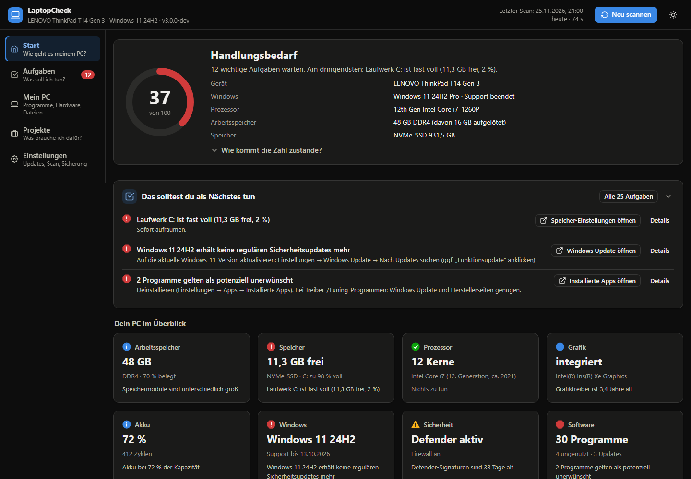
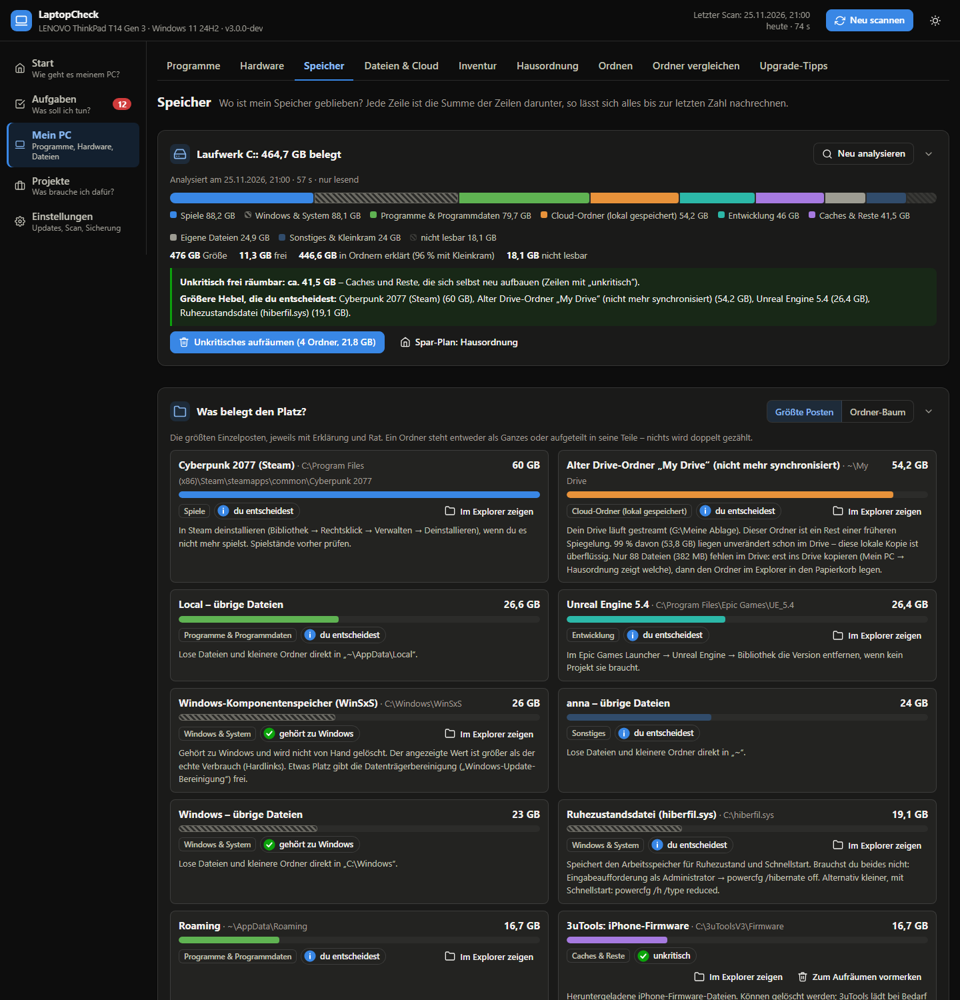
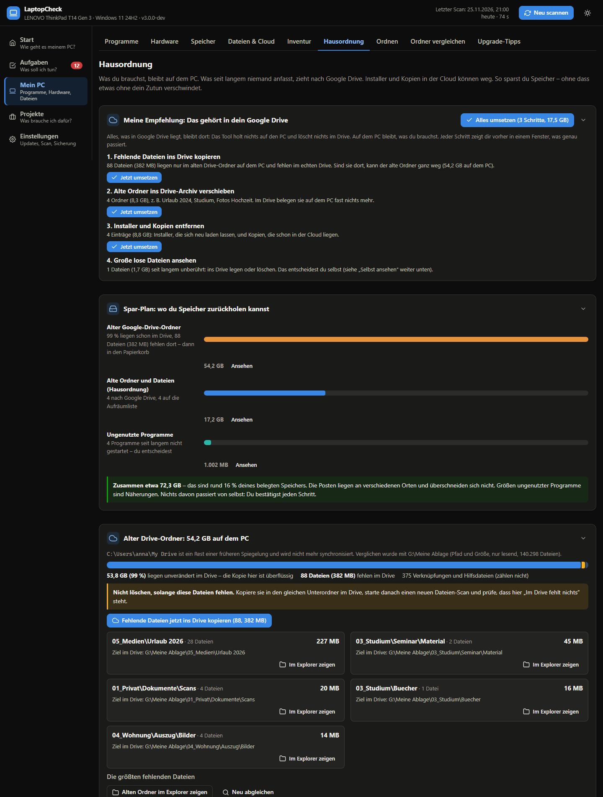
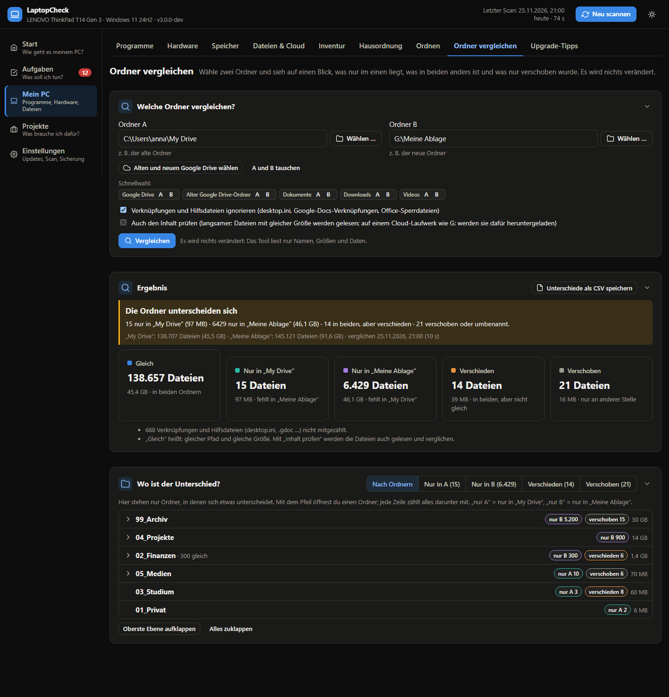
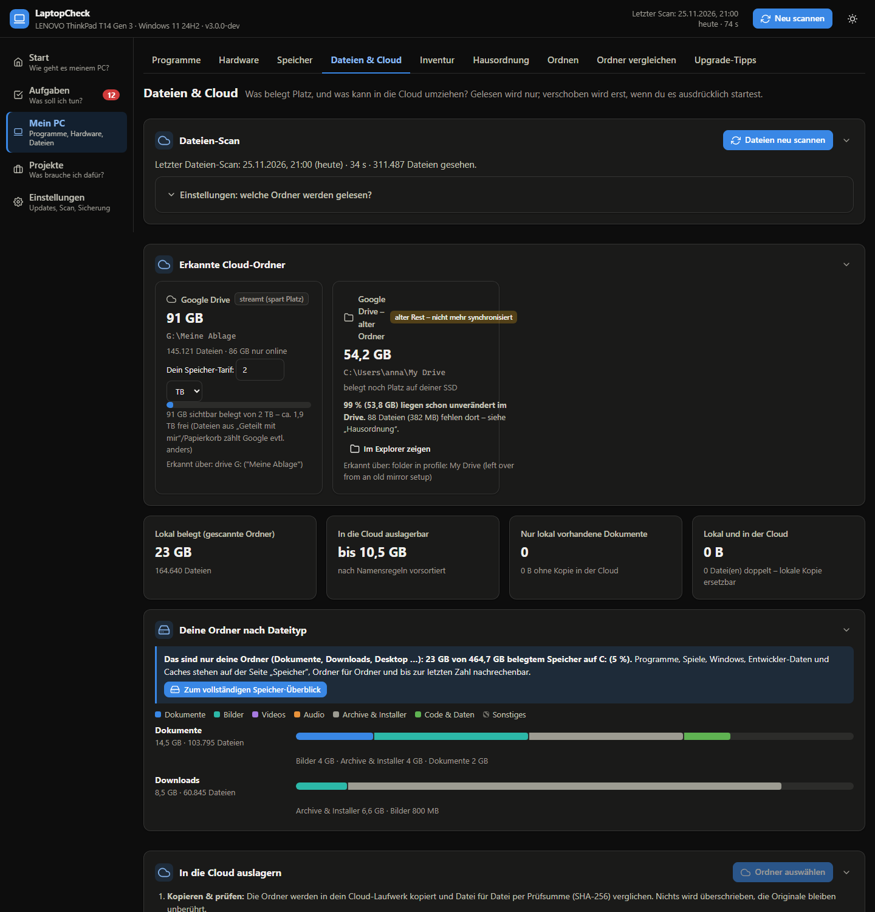
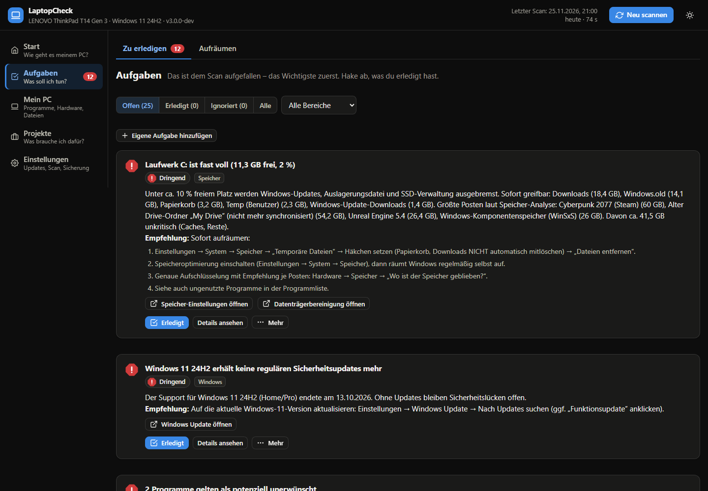
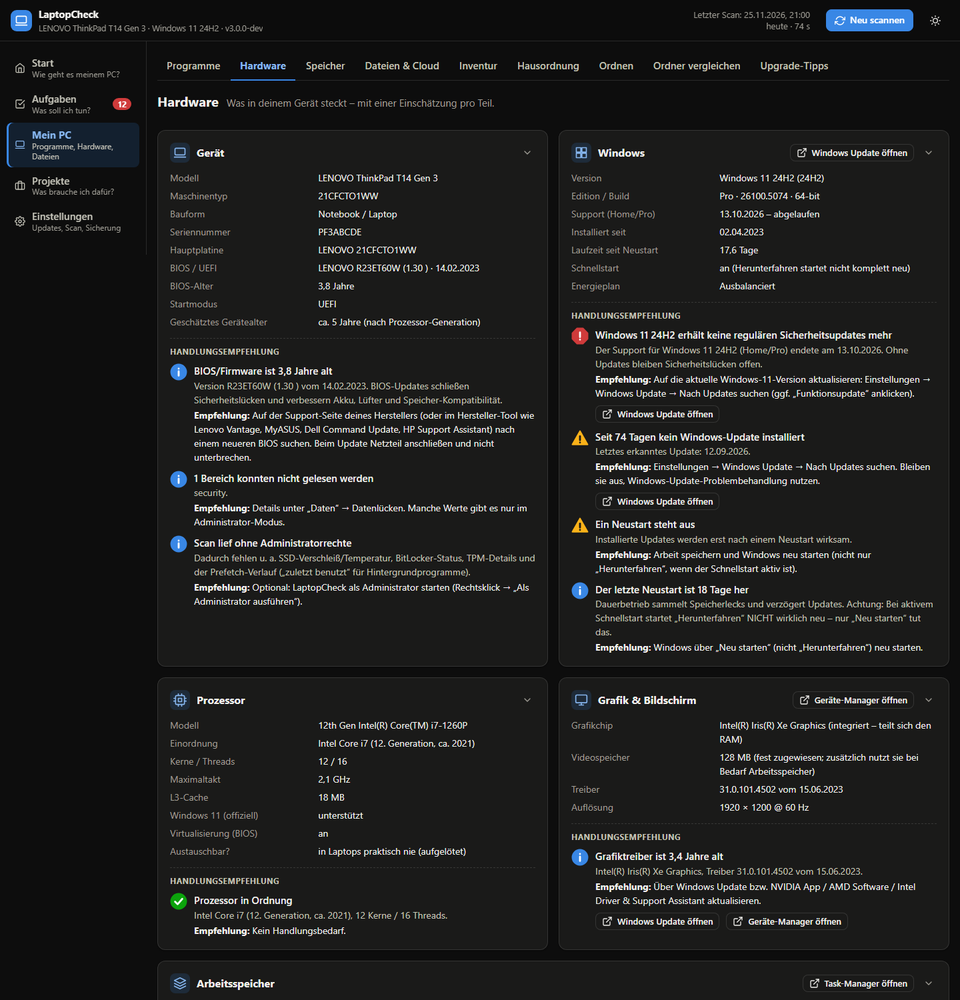

<div align="center">

# PC-Analyzer

**A local Windows dashboard that shows what is installed, how healthy the hardware is — and, above all, where your disk space went and what you can safely do about it.**

[](https://github.com/exUs541/PC-Analyzer/actions/workflows/ci.yml)
[](LICENSE)


[](https://github.com/exUs541/PC-Analyzer/releases/latest)



</div>

> The app itself is called **LaptopCheck**. Its dashboard is in German; the code, comments and developer documentation are in English. A German user guide is in [docs/user-guide.de.md](docs/user-guide.de.md).

## Why

Windows PCs fill up and age without anyone noticing: 90 GB of games, 54 GB of an old cloud-sync folder nobody remembers, installers from 2022, leftovers of programs that were uninstalled long ago. Task Manager and Settings show a few numbers; they do not explain them. PC-Analyzer reads everything once, **adds it up to the last byte**, tells you what each thing is, whether it can go, and how — and then lets you act on the recommendation in one click, with every destructive step confirmed and reversible.

## Highlights

- **Where did my disk space go?** A read-only analysis of the whole system drive, shown as a folder tree in which every row is the sum of the rows below it. Nothing is counted twice, unreadable areas are shown instead of hidden, and every large folder comes with an explanation and a way to remove it.
- **System health at a glance.** Hardware, Windows support dates, security, battery, memory modules (installed vs. usable vs. promised), startup items, programs with a *last used* date taken from Windows' own usage history, and a score with an explanation of every deduction.
- **House rules and a saving plan.** Folders nobody has touched for months are proposed for your cloud drive, installers and copies that already live in the cloud for the Recycle Bin. You set the limits; one click (after a dialog that lists exactly what happens) applies the recommendation.
- **Cloud-drive aware.** Detects Google Drive (streamed or mirrored), OneDrive, Dropbox and more; recognises a leftover mirror folder, compares it file by file with the live drive, and copies only what is missing — verified by SHA-256, never overwriting.
- **Compare any two folders.** One sentence says what the difference is; a folder tree shows where; lists show which files are only in A, only in B, different, or just moved. Read-only, exportable as CSV.
- **Safe by design.** Scans only read. Removal goes to the Recycle Bin after a window of its own asks for a typed confirmation word; the server re-checks every request and ignores anything it cannot verify.
- **Installs and updates itself** per user, without administrator rights ([Velopack](https://velopack.io)), and works completely offline otherwise. Nothing leaves your PC.

## Screenshots

| Storage: where did the space go? | House rules: recommendations in one click |
|---|---|
|  |  |

| Compare two folders | Files and cloud |
|---|---|
|  |  |

| Tasks with recommended actions | Hardware |
|---|---|
|  |  |

All screenshots show the built-in **demo data** (an invented laptop), not a real PC.

## Install

1. Download `LaptopCheck-win-Setup.exe` from the [latest release](https://github.com/exUs541/PC-Analyzer/releases/latest).
2. Run it. It installs for your user only, needs no administrator rights, and brings its own .NET runtime (~80 MB).
3. The first start scans your PC (1–2 minutes), then the dashboard opens.

The installer is not code-signed, so Windows SmartScreen may warn: *More info → Run anyway*. Source and builds are public; see [SECURITY.md](SECURITY.md).

## Try it with demo data

No scan of your own PC needed. You need Windows, the [.NET 10 SDK](https://dotnet.microsoft.com/download) and Node.js 20+:

```powershell
node tests/make-fixtures.js                  # invented base snapshot (once)
node tools/make-demo-data.js demo-data       # a pretend laptop: nearly full C:, Google Drive, old mirror folder, ...
dotnet run --project app/src/LaptopCheck.App -- --data-dir demo-data --web-root web
```

## Privacy and safety

- The dashboard server listens on **localhost only**, requires a random token per start and checks the `Host` header.
- The dashboard loads **nothing from the internet** (no CDN, no fonts, no telemetry).
- Network access exists only for the update check (GitHub releases), the optional GitHub repository list (only with a GitHub sign-in already on the PC) and `winget` (can be turned off).
- Scans read names, sizes and dates — never file contents (except the opt-in "compare content" mode, which hashes files of equal size).
- Details: [docs/architecture.md → Safety model](docs/architecture.md#safety-model).

## Tech stack

C# / .NET 10 · WinForms + WebView2 host · Kestrel (local API) · vanilla JavaScript dashboard (no framework, no build step) · Velopack (installer and updates) · xUnit and `node:test` (400+ tests) · GitHub Actions.

## Build and test

Requirements: Windows 10/11, [.NET 10 SDK](https://dotnet.microsoft.com/download), Node.js 20+.

```powershell
dotnet build app/LaptopCheck.slnx
dotnet test  app/LaptopCheck.slnx            # xUnit: scans, services, HTTP surface
node tests/make-fixtures.js
node --test tests/                           # dashboard logic (runs in Node, no browser needed)
./app/tools/pack.ps1 -Version 1.0.0          # installer and update packages (Velopack)
```

## Repository layout

```text
app/src/        C# solution: Core, Scan, Cleanup, GitHub, Update, Server, App
app/tests/      xUnit tests
web/            the dashboard (HTML, CSS, vanilla JS)
tests/          dashboard logic tests (node:test) and fixture generators
tools/          demo data generator
docs/           architecture, German user guide, screenshots
.github/        CI, release workflow, issue and pull request templates
```

## Documentation

- [Architecture](docs/architecture.md) — layers, modules, data, API, safety model, testing strategy
- [User guide (German)](docs/user-guide.de.md) — every page and feature explained
- [Contributing](CONTRIBUTING.md) · [Security policy](SECURITY.md) · [Code of conduct](CODE_OF_CONDUCT.md) · [Changelog](CHANGELOG.md)

## License

[MIT](LICENSE) © 2026 exUs541
